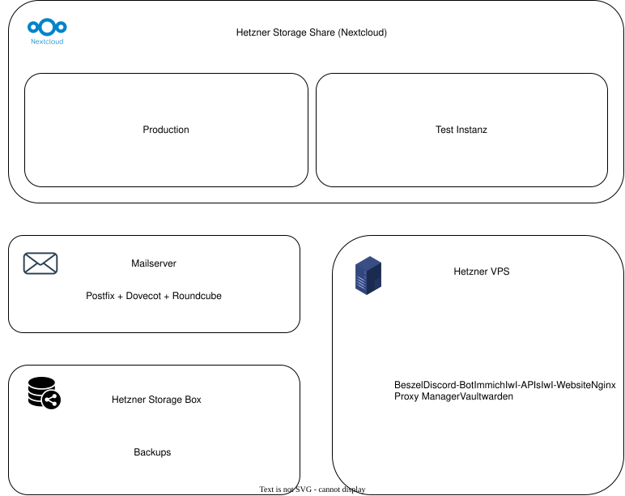

# FB-Infrastruktur Dokumentation

## Architekturübersicht

## Übersicht der Dienste
- Extern:
    - [Nextcloud AIO](./docs/services/nextcloud-aio.md)
    - [IwI Website](./docs/serhttps://nx17970.your-storageshare.de/vices/iwi-website.md)
    - [Discord-Bot](./docs/services/discord-bot.md)
    - [Immich](./docs/services/immich.md)
- Intern:
    - [Nginx Proxy Manager](./docs/services/nginx-proxy-manager.md)
    - [Vaultwarden](./docs/services/vaultwarden.md)
    - [Mailserver](./docs/services/mail-server.md)
    - [API](./docs/services/api.md)
    - [Beszel](./docs/services/beszel.md)

## Server Übersicht
Eine Server Übersicht gibt es in [server.md](./server.md).

## Struktur
Die meisten Dienste werden mit Docker Compose verwaltet und befinden sich unter `/opt`.

## Kosten
Eine Kostenübersicht über die Infrastruktur findest du [hier](https://cloud.iwi-hka.de/f/1179453).
